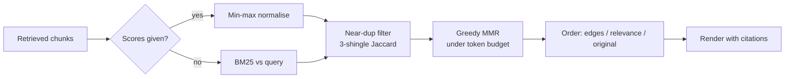

<div align="center">

# ctxpack

**Token-budget-aware context packing for RAG.**
Pick the *right* chunks, drop the near-duplicates, and order them so the model actually uses them, all inside a hard token budget.

[](https://github.com/roomeesyncss/ctxpack/actions/workflows/ci.yml)


</div>

---

## Why

Most RAG pipelines do `top_k=10` and paste everything into the prompt. That causes three problems:

| Problem | What happens | ctxpack fix |
|---|---|---|
| **Overflow / waste** | Context overflows the window, or burns tokens on low-value text | Hard token budget, enforced on the rendered context |
| **Redundancy** | Overlapping chunks from the same doc crowd out other evidence | Shingle-Jaccard dedup + MMR diversity |
| **Lost in the middle** | Models under-use evidence buried mid-context | `edges` ordering puts the strongest chunks first *and* last |

ctxpack is a small, **zero-dependency**, fully typed library that sits between your retriever and your LLM call.

## Install

```bash
pip install "git+https://github.com/roomeesyncss/ctxpack"
```

## Quickstart

```python
from ctxpack import pack

hits = [  # whatever your vector DB / retriever returns
    {"id": "a", "text": "MMR balances relevance and novelty...", "score": 0.91, "source": "ir.md"},
    {"id": "b", "text": "MMR balances relevance and novelty!", "score": 0.90, "source": "copy.md"},
    {
        "id": "c",
        "text": "Pack against an explicit token budget...",
        "score": 0.84,
        "source": "rag.md",
    },
]

result = pack(hits, budget=1500, diversity=0.3)

prompt_context = result.render()  # "[1] ir.md\n...\n\n[2] rag.md\n..."
print(result.summary())  # packed 2/3 chunks · 34/1500 tokens (2.3%) · dropped: 1 duplicate
for d in result.dropped:
    print(d.chunk.id, d.reason, d.detail)  # b duplicate near-duplicate of a
```

No retriever scores? Pass `query=` and ctxpack scores chunks with built-in **BM25**.

## CLI

```bash
# JSONL with {"id", "text", "score"?, "source"?} per line
ctxpack pack examples/knowledge.jsonl --budget 160

# Directory of .md/.txt files, split on blank lines and scored with BM25
ctxpack pack docs/ --query "rate limits and retries" --budget 2000 --format json

# Pipe from your retriever
my-retriever "query" | ctxpack pack - --budget 800 --order relevance
```

```text
$ ctxpack pack examples/knowledge.jsonl --budget 160 > context.txt
ctxpack: packed 3/8 chunks · 158/160 tokens (98.8%) · dropped: 1 duplicate, 4 over_budget

$ ctxpack pack examples/knowledge.jsonl --budget 160 -f json --quiet | jq -c '.dropped[:2][]'
{"id":"mmr-2","reason":"duplicate","detail":"near-duplicate of mmr-1"}
{"id":"bm25-1","reason":"over_budget","detail":"needs 41 tokens"}
```

## How it works



1. **Relevance.** Retriever scores are min-max normalised. Without scores, BM25 runs against `query`.
2. **Dedup.** Chunks are visited by relevance. Any chunk whose 3-term-shingle Jaccard with an already-kept chunk is at or above `dedup_threshold` is dropped, so the better copy survives.
3. **Selection.** Greedy [Maximal Marginal Relevance](https://www.cs.cmu.edu/~jgc/publication/The_Use_MMR_Diversity_Based_LTMIR_1998.pdf) as a knapsack. Each step picks, among chunks that **still fit**, the one maximising `(1 - diversity) · relevance - diversity · max_similarity_to_selected`. Max-similarity is updated incrementally, so selection is O(k·n).
4. **Ordering.** `edges` interleaves by rank, `[r1, r3, r5, … r4, r2]`, so the top two chunks sit at the start and end of the context.

### Guarantees

- `estimate_tokens(result.render()) <= budget` for the default estimator. The budget covers citation headers and separators, not only chunk text. A randomised test checks this over 200 trials.
- The default estimator is **sub-additive** and errs high (max of chars/4 and 1.1 × word pieces). Bring your own exact counter with `counter=your_fn`.
- Deterministic: ties break by input position.

## Use with Claude

[`examples/rag_with_claude.py`](examples/rag_with_claude.py) packs the context, asks Claude to answer **with `[n]` citations**, and prints the source map:

```bash
pip install "ctxpack[claude] @ git+https://github.com/roomeesyncss/ctxpack"
export ANTHROPIC_API_KEY=...
python examples/rag_with_claude.py "Why put the best chunks at the edges of the prompt?"
```

## API

```python
pack(chunks, budget, *, query=None, diversity=0.3, dedup_threshold=0.8,
     min_relevance=0.0, order="edges", counter=estimate_tokens,
     template="[{n}] {source}\n{text}", separator="\n\n") -> PackResult
```

| `PackResult` | |
|---|---|
| `.chunks` | Selected chunks in final order |
| `.render()` | Prompt-ready string with `[n]` headers |
| `.citations()` | `{n: Chunk}` for mapping model citations back to sources |
| `.dropped` | `Dropped(chunk, reason, detail)` where reason is `duplicate`, `over_budget` or `low_relevance` |
| `.tokens_used` / `.utilization` | Budget accounting |
| `.relevance` | Normalised relevance per chunk id |

## Development

```bash
pip install -e ".[dev]"
pytest && ruff check . && ruff format --check .
```

## Roadmap

- [ ] Sentence-level truncation to fill the last few hundred tokens
- [ ] Optional embedding-based similarity hook for semantic dedup
- [ ] Per-source quotas (e.g. at most 2 chunks per document)

## Author

**Rooma Siddiqui**, AI Engineer (RAG pipelines, AI agents, backend & automation)
GitHub [@roomeesyncss](https://github.com/roomeesyncss)

## License

[MIT](LICENSE) © 2026 Rooma Siddiqui
